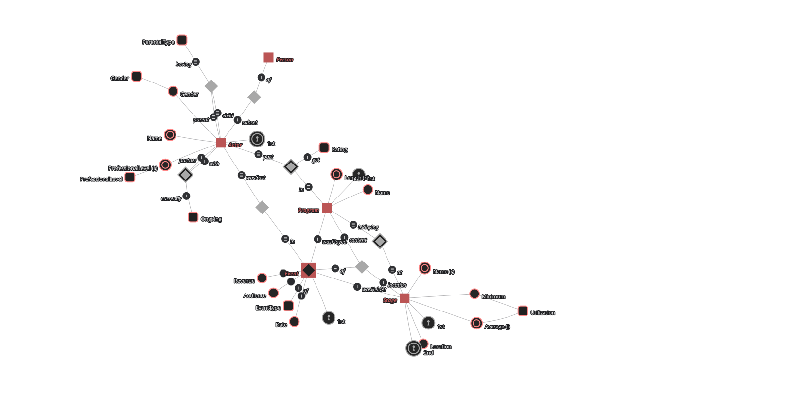

# Anchor Modeling constructs

This document explains the building blocks of an Anchor model, what each one is for, and how it
turns into database objects. It is written for anyone creating or reading models with this tool,
whether a person drawing in the modeler or an agent reading the XML to generate SQL or build a
semantic layer on top of the result.

Examples throughout come from [example.xml](../example.xml), a small model of a theatre business.
See http://www.anchormodeling.com for the theory behind the technique.

## The idea in brief

Anchor Modeling splits a domain into very small pieces, in the sixth normal form except where a
relationship must be recorded as a whole (see [ties](#atomic-relationships) and
[nexuses](#nexus)):

- **Things** that have an identity get their own table, holding nothing but that identity.
- **Every property** of a thing gets its own table.
- **Every relationship** between things gets its own table.

Because each piece lives on its own, the model can grow by adding new tables rather than
altering existing ones. Old queries keep working when the model is extended, and history can be
kept for exactly the properties and relationships that need it. Data is only ever added, never
updated in place, so a change is recorded as a new row with a later time rather than an
overwrite.

The result is many narrow tables, which often works in favor of query performance:

- A query that needs only a few attributes reads only their tables, which are much smaller than
  a wide table holding every property.
- A selective condition on one narrow table cuts down the rows early. A cost-based optimizer with
  column statistics can start from the most selective table and join outward, so the tables work
  much like indexes do.

For convenience, the generator also creates views, called perspectives, that join the pieces
back together into one wide row per thing. Optimizers that support join elimination skip the
tables a query against a perspective does not use.

## Constructs at a glance

| Symbol | Construct | XML element | Models | Becomes in the database |
|---|---|---|---|---|
|  | [Anchor](#anchor) | `<anchor>` | A thing with an identity, such as an actor or a stage | A table with one identity column |
|   | [Attribute](#attribute) | `<attribute>` | A property of an anchor or nexus, such as a name | A table of values, keyed by the owner's identity |
|  | [Knot](#knot) | `<knot>` | A small, shared set of values, such as genders | A lookup table of identities and values |
|   | [Tie](#tie) | `<tie>` | A relationship between anchors, such as who is cast in what | A table with one column per role |
|  | [Nexus](#nexus) | `<nexus>` | An event with its own identity and properties, such as a performance | A table holding the identity and its role references |
|   | [Role](#role) | `<role>` | How an anchor, nexus or knot takes part in a tie or nexus | A column in the tie or nexus table |
|   | [Key and identifier](#keys-and-identifiers) | `<key>`, `<identifier>` | A natural key, such as a stage being identified by its name | Key views (Snowflake, SQL Server) |

Where a construct has two symbols, the second, doubled outline marks the historized variant. On a
role, a single bar marks a role that is not an identifier and three bars mark an identifier role.

Most constructs can also carry a `<description>`, a `<metadata>` element with settings, and a
`<layout>` element with the diagram position.

## The example model



Stages (venues) play programs (shows). Actors have parts in programs and are cast in events.
An event is one performance of a program on a stage at a certain time.

## Anchor

An anchor represents a kind of thing in the domain that has an identity of its own and that you
want to say things about over time: a person, an actor, a stage, a program.

```xml
<anchor mnemonic="AC" descriptor="Actor" identity="int">
    <description>An actor, a person who performs parts in programs and is cast in events.</description>
    <attribute .../>
</anchor>
```

- `mnemonic` is a two-letter code, unique in the model. It prefixes every generated name.
- `descriptor` is the readable name, written in PascalCase.
- `identity` is the data type of the surrogate identity. Pick one large enough for the number of
  instances you expect.
- The generated table holds only the identity (`AC_Actor` with column `AC_ID`). Everything known
  about an actor lives in attribute and tie tables.
- Set `generator` in the metadata if the database should create identities for you from a
  sequence.

**Use an anchor when** the thing has an identity that persists while its properties change, and
other things relate to it. **Do not use an anchor when** the thing is just a value picked from a
short list, such as a status or a category. That is a [knot](#knot).

## Attribute

An attribute is a single property of an anchor or a nexus, such as an actor's name or an event's
audience size. Each attribute gets its own table.

```xml
<attribute mnemonic="NAM" descriptor="Name" timeRange="datetime" dataRange="varchar(42)">
    <description>Name of the actor, such as a stage name.</description>
</attribute>
```

- `mnemonic` is three letters, unique within its anchor or nexus.
- An attribute has either a `dataRange` (a data type, for its own values) or a `knotRange` (the
  mnemonic of a knot whose values it uses), never both.
- A `timeRange` makes it historized: every change is kept, stamped with the time it happened.

This gives four flavors:

| Flavor | Declared with | Example | Use when |
|---|---|---|---|
| Static | `dataRange` | Program name, event audience | The value is not expected to change once recorded |
| Historized | `dataRange` + `timeRange` | Actor name, program length | You need to know what the value was at an earlier point in time |
| Knotted static | `knotRange` | Actor gender | The value comes from a small shared set and does not change |
| Knotted historized | `knotRange` + `timeRange` | Actor professional level | The value comes from a small shared set and changes over time |

For the actor name in the example, the generated table is `AC_NAM_Actor_Name`, with the columns:

- `AC_NAM_AC_ID`, the actor it belongs to
- `AC_NAM_Actor_Name`, the value
- `AC_NAM_ChangedAt`, the time the value became valid

A knotted attribute stores a reference to the knot instead of a value, and the perspectives join
in the knot's value for you.

**Settings in `<metadata>`:**

- `restatable`: whether the same value may be recorded twice in a row over changing time (a
  restatement). Turn it off to add a constraint that rejects restatements with an error.
- `idempotent`: if on, the triggers silently skip a restatement instead of storing it, so loading
  the same data again changes nothing. This holds even when restatements are allowed. Not
  recommended when data can arrive out of order with respect to changing time.
- `assertive` (bi and crt): if on, the same value asserted again later with the same reliability
  gets an assertion of its own. If off, the triggers silently skip such a re-assertion.
- `deletable`: allows "deleting" values by updating to null, moving the affected rows to a
  deletion table.
- `equivalent`: allows several equivalent values at once, for example one per language or per
  tenant.
- `checksum`: adds a computed checksum column, for data types too large to index.
- `privacy`: what to do if the data becomes subject to privacy regulation, such as a GDPR request
  to be forgotten. This is informational only.
- `encryptionGroup`: marks the data for encryption at rest, grouped by the name given.

## Knot

A knot is a small, shared set of values that rarely or never changes, such as genders, ratings or
event types. Knots keep repeated strings out of attribute and tie tables and give one place to
maintain the list.

```xml
<knot mnemonic="RAT" descriptor="Rating" identity="tinyint" dataRange="varchar(42)">
    <description>Rating of how well an actor performs a part in a program.</description>
</knot>
```

- `mnemonic` is three letters, unique among knots.
- `identity` is usually a small type such as `tinyint`, since the set is small.
- `dataRange` is the type of the values themselves.
- A knot is used through a `knotRange` on an attribute, or through a role in a tie or nexus.
- `equivalent` and `checksum` work as for attributes.

**Use a knot when** the values form a closed, fairly stable list that many rows refer to.
**Use a plain attribute when** the values are open-ended, such as names, amounts or dates.

## Tie

A tie is a relationship between two or more anchors, possibly including knots. Each participant
takes part through a [role](#role), and a tie must involve at least two anchor roles (the same
anchor may appear twice, as in parent and child).

```xml
<tie timeRange="datetime">
    <role role="part" type="AC" identifier="true"/>
    <role role="in" type="PR" identifier="true"/>
    <role role="got" type="RAT" identifier="false"/>
</tie>
```

The tie's name is built from its roles, so the example above becomes `AC_part_PR_in_RAT_got`,
with the columns `AC_ID_part`, `PR_ID_in` and `RAT_ID_got`.

### Cardinality

The `identifier` flag on each role decides the cardinality. Roles marked as identifiers together
form the primary key of the tie.

| Identifier roles | Cardinality | Example |
|---|---|---|
| All anchor roles | Many-to-many | An actor can be cast in many events, and an event casts many actors (`EV in`, `AC wasCast`) |
| Some anchor roles | Many-to-one, from the identifier side | Each event has one program and one stage (`PR content`, `ST location`, `EV of`, where only the event is an identifier) |
| None | One-to-one | An actor has at most one partner at a time, and the partner has at most one partner too (`AC partner`, `AC with`) |

A knot role marked as an identifier is part of the key, so the same pair of anchors can be
related once per knot value (parent and child, once per parental type). A knot role not marked
as an identifier is a value of the relationship, such as the rating an actor got for a part.

### Atomic relationships

A tie with identifier roles and more than one non-identifier role is in the fifth normal form
rather than the sixth. It could be split into one tie per non-identifier role without losing any
data, but the split would lose a constraint: that the relationship is always recorded as a whole,
never with some of its parts missing. Use such a tie when that requirement holds. The example's
`PR content`, `ST location`, `EV of` states that an event always has both a program and a stage,
recorded together. Two separate ties would allow an event with a stage but no program.

### Flavors

As with attributes, a tie is static or historized (with a `timeRange`), and knotted or not:

- **Static tie:** the relationship holds once established, such as an actor being a person.
- **Historized tie:** the relationship can begin and end, such as which program a stage is
  playing. A new row with a later time replaces the earlier one.
- **Knotted tie:** carries a value from a knot, such as a rating.

A historized tie cannot delete a relationship that has ended, since history is only added to. A
common pattern is to include a knot role that records the state, as the `Ongoing` knot does for
partnerships: the end of a partnership is recorded as a new row saying it is no longer ongoing.

Ties support `restatable`, `idempotent`, `assertive` and `deletable` in their metadata, with the
same meaning as for attributes.

## Nexus

A nexus is an event-like entity: something that happens at a point in time, involves one or more
anchors, and has properties of its own. In the example, an event is one performance of a program
on a stage, with a date, an audience size and a revenue.

```xml
<nexus mnemonic="EV" descriptor="Event" identity="int">
    <attribute mnemonic="DAT" descriptor="Date" dataRange="datetime" chronicle="1"/>
    <attribute mnemonic="AUD" descriptor="Audience" dataRange="int"/>
    <role role="wasHeldAt" type="ST" identifier="false"/>
    <role role="wasPlayed" type="PR" identifier="false"/>
    <role role="of" type="ETY" identifier="false"/>
</nexus>
```

A nexus combines features of an anchor and a tie:

- Like an anchor, it has its own identity (`EV_ID`) and can have attributes.
- Like a tie, it has roles that reference anchors and knots. It must reference at least one
  anchor. Its roles are stored as columns on the nexus table itself, and they are never
  identifiers, because the nexus's own identity already identifies it.
- Ties can reference a nexus, as the casting tie does: `EV in`, `AC wasCast`.
- The nexus itself is immutable once recorded, so its roles are static.
- A nexus is equivalent to an anchor with one static tie per role. Storing the roles together on
  one table puts a nexus with more than one role in the fifth normal form rather than the sixth,
  for the same reason as for [atomic ties](#atomic-relationships): every event is recorded with
  all its roles at once, and none of them can be missing.

**Chronicle.** An attribute with a `chronicle` ordinal of 1 or more places the nexus in time.
Every nexus should have at least one, and the modeler warns if it has none. If several attributes
are marked, the ordinal orders them.

**Use a nexus when** a relationship is really a happening in its own right: it has its own
properties, other things need to refer to it, or the same anchors can be involved in it many
times. **Use a tie when** the relationship is fully described by who takes part, with at most a
knot value and a history of changes.

The example deliberately models the event's program and stage twice, once as nexus roles and once
as the tie `PR content`, `ST location`, `EV of`, to show both styles side by side. In a real model
you would pick one.

## Role

A role says how a participant takes part in a tie or a nexus.

- `role` is the name of the part played, written in camelCase. It must be unique within its tie,
  which is what lets the same anchor take part twice, as with `parent` and `child`.
- `type` is the mnemonic of the anchor, nexus or knot playing the role.
- `identifier` makes the role part of the key. See [cardinality](#cardinality).
- `coloring` is a diagram color only, with no effect on the database.

Choose role names that read as a sentence together with the anchors: "actor **part** (in)
program **in**, **got** rating".

## Keys and identifiers

Surrogate identities (`AC_ID`) are what the model uses internally, but data from source systems
usually arrives with natural keys: a stage is known by its name, an event by its date, stage and
program. Keys describe these natural keys so that incoming data can be matched to existing
identities.

A **key route** is a path through the model that collects the values making up one natural key.
Each step on the path is a `<key>` element placed on an attribute or a role:

- `of` is the anchor or nexus being identified.
- `route` names the key, such as `1st` or `2nd`, so one entity can have several natural keys.
- `stop` is the position of this step along the path.
- `branch` separates parallel paths within the same route.

The event's first route in the example goes through three branches:

| Stop | Branch | Element | Contributes |
|---|---|---|---|
| 1 | 1 | `EV` attribute `Date` | The date of the event |
| 2 | 2 | `EV` role `wasHeldAt` | A path to the stage |
| 3 | 2 | `ST` attribute `Location` | The stage's location |
| 4 | 3 | `EV` role `wasPlayed` | A path to the program |
| 5 | 3 | `PR` attribute `Name` | The program's name |

So an event is identified by its date, the location of its stage and the name of its program.
The stage itself has two routes: the `1st` by location and the `2nd` by name.

Each branch starts at the anchor or nexus that `of` names and ends in a value. The stops are
numbered across the whole route, in the order the values make up the key, and along each branch in
the order it is walked:

- An attribute of what the branch has reached is a value, and ends the branch. A knotted attribute
  gives the value of its knot.
- A role of a nexus leads from the nexus to what the role refers to, in one stop, as `wasHeldAt`
  does above. A knot role, of a nexus or a tie, gives the value of its knot and ends the branch.
- A tie takes two stops in a row: the role the branch enters it by and the role it leaves it by.
  Both are needed, since an anchor can play more than one role in a tie, as an actor is both
  `parent` and `child`.

A route gives every identity one key only if every step on it is functional. An attribute and a
role leading out of a nexus always are. A tie is functional when no role other than the one it is
entered by is an identifier, and a branch that enters a nexus by one of its roles never is, since an
anchor can take part in many. A route that passes a historized attribute or tie changes over time.
Uniqueness, that no two identities have the same key, is a property of the data, which the model
cannot promise.

An `<identifier route="..."/>` on an anchor or nexus declares that the route is used as an
identifier for it. An identifier is historized if an attribute or a tie on its route is historized,
since the key can then change over time.

In the modeler, keys are drawn as routes on the diagram. To make one, select the anchor or nexus it
identifies and then what the route passes, in order (attributes and roles; a knot is not a stop),
and pick *Create key from selected*; *Add selected to key* continues the selected route, on a new
branch when the anchor or nexus is in the selection too. When a model is opened, the modeler checks
its routes with the same rules as the generators and writes what is wrong to the browser's console.

Snowflake and SQL Server (uni, bi and crt) turn every route into three objects:

- `key_<anchor>_<route>`, a view with the key of every identity, from the latest perspectives. A
  value that has a checksum, such as a geography, is followed by the checksum, which is what it is
  matched on (`hash(value)` in Snowflake, the MD5 of the value in SQL Server).
- `pkey_<anchor>_<route>(changingTimepoint)`, the key of every identity at a changing time, for a
  route that passes something historized.
- `ic_key_<anchor>_<route>`, the keys that more than one identity has and the identities that have
  more than one key, since neither database enforces that on a view. In Snowflake
  `IntegrityViolations` includes it.

With `naturalKeyAttributes` (*Create natural key attributes*), SQL Server also makes a table of the
key of every identity that has all of its values, `<anchor>_<route>`, with a primary key on the
identity and a unique constraint on the key, and a procedure that fills it from the key view,
`refresh_<anchor>_<route>`. The procedure fails, and leaves the table as it was, when two identities
have the same key; the table gives lookups an index.

A route that breaks one of the rules above is left out, with a comment in the script that says why,
and one that is not functional is generated with a comment that says where. In crt every key is per
positor. Other targets keep the keys in the model without generating objects from them.

## Descriptions

Add a `<description>` to anchors, attributes, knots, ties, nexuses and roles, and one directly
under `<schema>` for the model as a whole. Descriptions are written to the database as comments,
which catalogs, documentation tools and AI agents building semantic models can read.

Good descriptions say what an instance is, not how it is stored: "A single performance of a
program held at a stage", not "Nexus table for events". For attributes, mention the unit or format
when it is not obvious, and for knots, give example values.

## Capsules

A capsule groups parts of a model into a separate database schema, for separation of concerns.
It is set per construct in `<metadata capsule="..."/>` and defaults to the model's encapsulation
setting (`dbo` unless changed).

## Generated objects and naming

With the default naming, names are built from mnemonics and descriptors:

| Object | Pattern | Example |
|---|---|---|
| Anchor table | `{mnemonic}_{descriptor}` | `AC_Actor` |
| Anchor or nexus identity | `{mnemonic}_ID` | `AC_ID` |
| Attribute table and value column | `{anchor}_{attribute}_{anchor descriptor}_{attribute descriptor}` | `AC_NAM_Actor_Name` |
| Attribute changing time | `{anchor}_{attribute}_ChangedAt` | `AC_NAM_ChangedAt` |
| Knot table and value column | `{mnemonic}_{descriptor}` | `GEN_Gender` |
| Tie table | `{type}_{role}` for each role, joined by `_` | `AC_part_PR_in_RAT_got` |
| Tie role column | `{type}_ID_{role}` | `AC_ID_part` |

The generator also creates perspectives, which join an anchor, nexus or tie together with its
attributes and knots into one row:

| Perspective | Prefix | Shows |
|---|---|---|
| Latest | `l` | The most recent value of everything, for example `lAC_Actor` |
| Point-in-time | `p` | Values as they were at a given time (a function taking the time) |
| Now | `n` | Values as of the current time |
| Difference | `d` | Every change between two times |

For querying and for semantic models, the latest perspectives are usually the right starting
point, rather than the individual tables.

## Temporalization

The model's temporalization setting decides what kinds of time the database keeps:

- **uni** (uni-temporal) keeps changing time only: when a value became valid in the domain.
- **crt** (concurrent-reliance-temporal) also keeps when each value was recorded, by whom (the
  positor), and how reliable it is thought to be, so that conflicting or retracted statements can
  coexist.
- **bi** (bitemporal) keeps changing time and the time each value was recorded (positing time),
  using the same posit and annex tables as crt.

The constructs and the model are the same in all three. Only the generated tables and
perspectives differ.

## Loading through the latest views

In SQL Server the latest views have triggers, so that data can be loaded with plain `INSERT`,
`UPDATE` and `DELETE` statements against them. Every statement is turned into new rows, since
history is only added to. The same rules hold for attributes and ties, in all three
temporalizations:

- **An insert** states each value given, valid from its changing time, or from now if none is
  given.
- **An update** states only what it changes. A value set to what it already is states nothing,
  unless a changing time or a positing time is set too, which states it again on purpose. A
  new value is a new version from the changing time given, or from now.
- **A static attribute or tie** behaves as if all its values had the same changing time. In
  uni, a value can be added where none is shown, and another value is an error (a
  contradiction). In bi and crt, another value corrects the shown one (see "Corrections"
  below).
- **A reliability without a new value** (bi and crt) asserts the shown version again with that
  reliability. A reliability of 0 retracts it.
- **Null** in a value retracts the shown version in bi and crt. In uni, for a deletable attribute
  whose deletable column is set to 1 in the same update, it moves the history to a deletion table;
  otherwise it does nothing.
- **A delete** retracts the shown versions in bi and crt, each for the positor of the row. In
  uni it removes the shown versions.

The latest views of nexuses take the same statements as those of anchors, in all three
temporalizations; the roles of a nexus are part of its identity and cannot be updated.

The settings then decide what happens to what is stated, the same way for inserts and updates:

| What is stated | What happens |
|---|---|
| Something already stored (identical) | Nothing |
| The same value again later in changing time (a restatement) | Skipped if idempotent; otherwise stored if restatable, or an error |
| The same reliability again later in positing time (a re-assertion, bi and crt) | Stored if assertive, otherwise skipped |
| Another value at a changing time that already has one (uni only) | An error, whatever the settings say |
| Another value at a changing time where the positor holds one (bi, and crt with decisiveness) | A correction: the held posit is retracted at the new positing time |
| Another value at a positing time where the positor holds one (bi, and crt with decisiveness) | An error, whatever the settings say |
| Another reliability for a version at a positing time that already has one (bi and crt) | An error, whatever the settings say |
| An assertion that would make what the positor holds contradict itself (crt without decisiveness) | An error, whatever the settings say |

In bi and crt a later assertion corrects an earlier one, and in crt positors may disagree. What
cannot hold is two assertions of the same version, by the same positor, at the same positing time:
that is a contradiction, as another value at a taken changing time is in uni (a delete, which
writes its retractions directly, is refused by the key of the table instead).

The positing time is now (`sysdatetime()`) unless it is given, and the clock does not necessarily
move between two statements in a row. A retraction or a new reliability that follows the assertion
it is about within the same tick would get the same positing time and be refused as a
contradiction, so give positing times explicitly when statements about the same version follow
each other closely.

### Corrections

Another value at the same changing time, or any other value of a static attribute or tie, is a
correction: in transitional terms, a retraction of the posit that was held and an assertion of the
new one, both at the positing time of the new value. The triggers write the retraction as a row of
its own, with reliability 0 (the delete reliability in crt), so the data says what happened.
Retracting the correction later therefore leaves nothing of the corrected value in effect, where it
used to come back. A historized correction retracts only the version it corrects, so retracting it
shows the version before.

- **bi** is decisive: one value at a time is asserted. Every assertion, inserted or updated,
  retracts the posit in effect at its changing time when that has another value. The constraint
  of each assembled view has the reliability, so that the retraction and the new assertion can
  share a positing time; running the generated SQL again on an older database makes an older
  constraint again with it.
- **crt with decisiveness** works the same way, for each positor on its own: what one positor
  asserts never retracts what another holds. A decisive positor holds a single assertion in effect
  at a time, positive or negative (as the transitional modeling paper defines decisiveness), so a
  negative assertion of another value retracts what was held as well.
- **crt without decisiveness** lets a positor hold several values at once. An insert adds an
  alternative and retracts nothing. An update of a value at the changing time of the shown version
  (always, for a static attribute or tie) is a correction, which retracts the shown posit before
  the new value is asserted. The latest and point-in-time views still show one row for each
  identity and positor, the latest positive assertion; the assembled views show every value that
  is held, for whoever wants to weigh the alternatives.

What a positor holds may not contradict itself. In decisive models that is so by construction,
and another value at a positing time where the positor already holds one is refused as a
contradiction, since which of the two was meant cannot be told. Without decisiveness the triggers
apply the non-contradiction of transitional modeling: in what the positor holds at the changing
time of a new assertion, as of its positing time, a positive reliability counts as it is and a
negative one as one plus it, and the sum may not be more than one. "40 percent not A" and "40
percent not B" are 60 percent A and 60 percent B, which is refused; being certain that any number
of values are not it is not. The check is made on the slice that the new assertion is in (its
positor, its changing time, its positing time), which is the only one an assertion that arrives in
order can make contradictory: other changing times are slices of their own, and a retraction only
lowers the sum.

A correction to the value that the version before already has is a restatement. An idempotent
attribute or tie skips the restatement, but in a decisive model it still retracts what it corrects;
one that may not be restated refuses it, and the version has to be retracted instead.

A tie has corrections when it has identifiers and other roles: other values for the same
identifiers. A tie without identifiers is all identity, so another value is another posit, and
nothing is retracted.

Only the posit in effect is retracted, the one that would be shown. In a database loaded before
corrections retracted, a positor can hold several values from earlier corrections; they are left as
they are, and a correction retracts the one in effect.

**Assertions that arrive late.** The rules above hold when each positor's assertions arrive in the
order of their positing times. An assertion posited before one already stored is stored with its
start: it retracts what was held before it, at its own positing time. Nothing ends it, though:
with decisiveness it should end at the next assertion of another value that is already stored,
and the triggers do not move or add that retraction, since that would change rows already written
on what may be a wrong positing time. The views still show the later assertion after its positing
time; only if that one is retracted does the late one show where nothing should. Without
decisiveness the non-contradiction check is only made at the positing time of the late assertion,
not at the later ones it also falls in. Load in positing order, or check the result, when the
order cannot be relied on.
